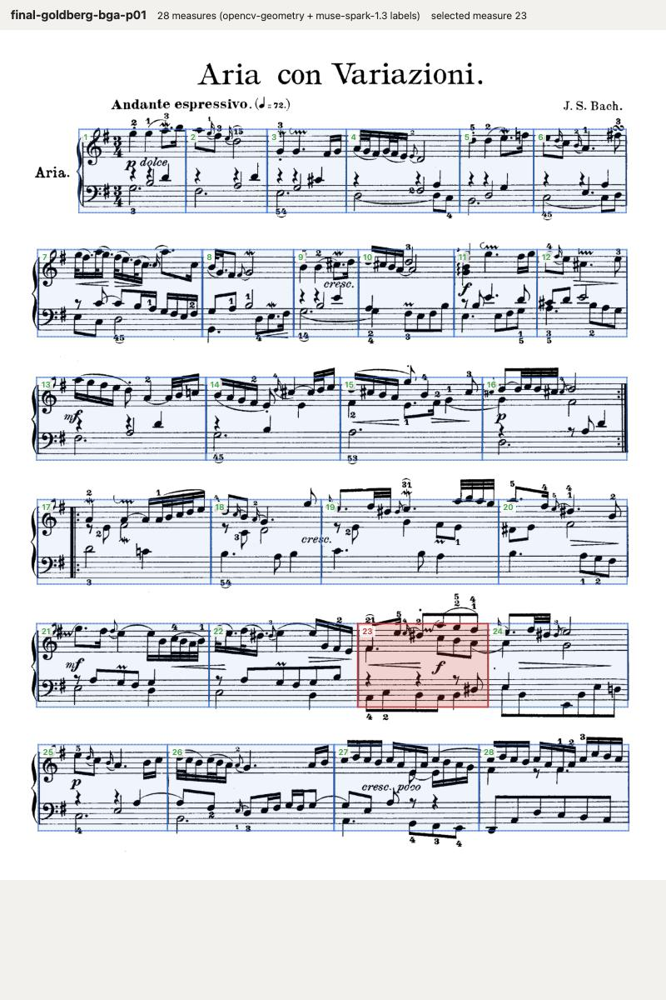
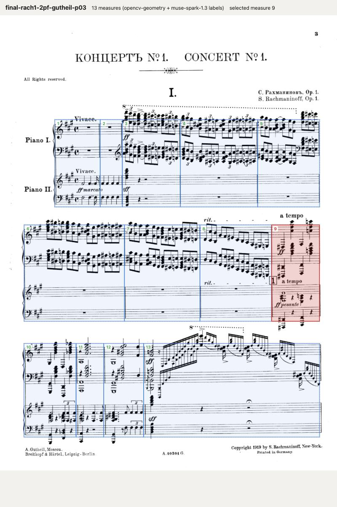

# Visual-grounding experiment (build-queue item 0)

Can SAM 3.1 + Muse Spark place measures on a scanned page well enough that tapping measure N selects measure N,
every time, on a clean page and a noisy page? Run on 2026-10-27. **Verdict: no. OpenCV staff-and-barline
geometry wins; Spark numbers and labels what geometry found.** Both pages pass the tap test with that split.

Everything here is plain scripts, run from `api/` with `uv run experiments/grounding/<script>.py`
(PEP 723 inline deps; the main `pyproject.toml` is untouched). Keys come from `api/.env`.

## Inputs

| Page | File | Why | Measures (ground truth) |
|---|---|---|---|
| Clean | `pages/goldberg-bga-p01.png` (Bach-Gesellschaft Goldberg, p. 1, the Aria) | crisp 1-bit scan, piano grand staff, repeat barlines | 28: systems of 6, 6, 4, 4, 4, 4 |
| Noisy | `pages/rach1-2pf-gutheil-p03.png` (Rachmaninoff Concerto 1, two-piano reduction, Gutheil 1919, p. 3) | grey scan, 0.5° skew, four staves per system, Cyrillic header, cross-staff beams, 8va dotted lines | 13: systems of 5, 4, 4 |

Rasterised with PyMuPDF at 150 dpi, greyscale (1274×1624 and 1416×1907 px). Ground truth is in
`ground_truth.json`: hand-verified barline x positions from zoomed crops. Two traps on the Rachmaninoff page:
the line at x≈685 in system 3 is a cross-staff stem (the sff chord and the cadenza run are one bar), and the
thin line at x≈320 is a real barline between two chord bars.

## Pass criterion and grader

`grade.py` simulates a tap on the centre of every ground-truth measure. The smallest predicted box under the tap
must carry the right number; every predicted box must be hit exactly once; the count must match. One wrong tap
is a fail. (Both final overlays were also tapped by hand in the browser; screenshots below.)

## Results

| Engine | Goldberg (28) | Rachmaninoff (13) | Latency per page | Cost per page |
|---|---|---|---|---|
| Spark 1.3, whole page, effort low | 23/28, 27 boxes, **fail** | 13/13, **pass** | 16 s / 11 s | $0.019 / $0.013 |
| Spark 1.3, whole page, effort medium | 9/28, **fail** | 2/13, **fail** | 22 s / 28 s | $0.022 / $0.030 |
| Spark 1.3, whole page, effort high | 9/28 (4 taps hit nothing), **fail** | 1/13, **fail** | 36 s / 27 s | $0.034 / $0.025 |
| SAM 3.1 system boxes → Spark per system, effort low | 10/28, **fail** | 1/13 (SAM boxes overlapped, 2 systems), **fail** | 49 s (6 calls) / 27 s | $0.043 / $0.031 |
| **OpenCV geometry** (`fallback_cv.py`) | **28/28 pass** | **13/13 pass** | 0.03 s / 0.02 s | $0 |
| **OpenCV geometry + Spark labels** (`label_with_spark.py`, the winner) | **28/28 pass** | **13/13 pass** | 6.4 s / 6.5 s | $0.008 / $0.008 |

Spark's failure mode is not noise, it is drift: on Goldberg it merges two bars somewhere around system 2 or 3 and
every later number is off by one; at medium and high effort the boxes also slide vertically across systems
(box 21–23 straddles systems 4 and 5). On the noisy page it loses the three thin barlines in the chord bars of
system 3. Low effort happened to pass the Rachmaninoff page once; that is not a result anyone should build on,
and higher effort made it worse, not better (more reasoning tokens, same eyes). Giving Spark one system at a
time at higher pixel density did not help either.

SAM 3.1 contributed one useful thing and one unreliable thing:

- `"musical staff"` on the clean page returned exactly the six systems (one box each, confidence ≈ 0.75).
  `"sheet music"` returned the page. `"sheet of paper"` returned the page on the noisy scan only.
- `"staff"`, `"staff lines"`, `"measure"`, `"bar line"`, `"grand staff"`, `"piano staff"`, `"music system"`,
  `"row of sheet music"` returned nothing on either page. `"line of music"` on the noisy page returned six
  grand staves (two per system) whose boxes overlap their neighbours, so merging them by gap fails.
- SAM never sees a barline, so it cannot place measures; at best it crops systems. Geometry does that in
  30 ms without a network call, so the final pipeline does not use SAM. Cost was $0.0025 per call, 0.6–5.9 s.

Total spend for the experiment: about $0.35 (25 SAM images, 10 whole-page Spark calls, 9 per-system Spark
calls, 2 labelling calls).

### What the winning pipeline does

1. `fallback_cv.py`: binarise (Otsu OR adaptive mean threshold, because the grey scan prints staff lines
   lighter than Otsu's global threshold), estimate skew by maximising the row-projection energy (−0.5° on the
   Rachmaninoff page), find staff lines as rows with long horizontal runs, group them in fives, group consecutive
   staves into grand staves **when a vertical line crosses the gap between them away from the left edge** (a
   piano's barlines run through its gap; between two pianos they stop), group grand staves into systems by the
   left systemic line, then call a column a barline when its vertical dark run covers ≥ 92 % of every grand
   staff in the system. Clusters inside the header zone (12 staff spaces from the systemic line: start repeats,
   clef and key strokes) merge into the system start. Measures are the spans between consecutive barlines,
   numbered top-left to bottom-right.
2. `label_with_spark.py`: Spark gets the page with the found boxes drawn and provisionally numbered, and is asked
   only for what geometry cannot know: the real number of the first measure (printed numbers, pickup bars),
   part names per system, rehearsal marks, measures that look wrong, title and composer. It never moves a box.
   On both pages it answered correctly (first measure 1; "Piano" / "Piano I, Piano II"; rehearsal mark 1 on
   measure 9; title and composer read, including the Cyrillic). It flagged nothing as doubtful, including the
   spurious bar OpenCV produced in an earlier run, so its doubt flag is weak; the confidence flag in the record
   should come from geometry (barline width, coverage, header-zone merges) with Spark as a second opinion.
3. `build_overlay.py`: static HTML with one absolutely positioned div per measure (percent coordinates, so it
   scales with the image), tap → highlight + readout; plus a PNG render.

Known limits of the geometry, to handle in item 6 rather than here: a cross-staff stem that spans a single
piano's grand staff would read as a barline on solo-piano pages (on the two-piano page it was rejected because
it did not span Piano II); pickup bars narrower than the header zone would be swallowed; boxes are in the
deskewed frame, so on a 0.5° page they sit up to 4 px off at the far corners (fine for tapping, could be mapped
back); orchestral pages with barlines broken between every staff will produce one "grand staff" per staff,
which the coverage rule still handles, but staves with no barline crossing at all (percussion, text-only) will
not join a system.

## Screenshots (overlay page, tapped in the browser)





Open the pages yourself with any static server from this folder, e.g. `python3 -m http.server 8765` then
`http://localhost:8765/out/final-goldberg-bga-p01.html`. Other overlays: `out/spark-*.html` (Spark whole page,
low effort), `out/spark-crops-*.html`, `out/cv-*.html`.

## Files

| File | What |
|---|---|
| `common.py` | env loading, Meta client (`POST /v1/responses`, Bearer key), prices |
| `run_sam.py` | SAM 3.1 prompt sweep; parses `<\|box;…\|>` records, decodes masks with `meta-sam-parser` |
| `run_spark.py` | Spark whole-page grounding on the 0–1000 grid (`--effort`, `--tag`) |
| `run_spark_crops.py` | SAM system boxes → per-system Spark grounding |
| `fallback_cv.py` | OpenCV staff/barline geometry → `out/cv-*.json` |
| `label_with_spark.py` | Spark labels the geometry → `out/final-*.json` (records in the proposed shape) |
| `build_overlay.py` | any measures JSON → tappable HTML + PNG |
| `grade.py` | tap test against `ground_truth.json` |
| `out/` | every run's JSON (raw text, usage, latency), overlays, screenshots |

## Meta Model API notes (verified 2026-10-27)

- Base `https://api.meta.ai/v1`, `Authorization: Bearer $META_API_KEY`. `/models` lists `sam-3.1`,
  `muse-spark-1.3`, `muse-spark-1.3-contributor`, `muse-voice-transcribe-1.0`, `muse-image-1.0`, `muse-wonder-1.0`.
- Spark answers on `/chat/completions`, `/responses` and the Anthropic-style `/messages`. Reasoning is
  `reasoning_effort` (chat) or `reasoning: {effort}` (responses); `none` is refused, `low`…`max` accepted.
  Reasoning tokens are billed as output: a 50-token `max_tokens` chat call returned no text because 48 tokens
  went to reasoning. Use `max_output_tokens` generously.
- Images: `input_image` with a base64 data URL; positions come back on a 0–1000 grid, top-left origin.
- SAM 3.1 goes through `/responses` too: `input_text` = noun phrase, `input_image`. Output is one text line
  `<0f>0<|box;x1=…;y1=…;x2=…;y2=…;w=…;h=…;c=…|><|mask;x=0;y=0;data=H,W,~base85|>,1…`. Boxes are source
  pixels (x2/y2 inclusive); masks decode with `meta_sam_parser.decode_mask_to_raster`. Empty text = no match.
  `metadata.include_confidence: "true"` adds `c=`.
- Prices (dev.meta.ai pricing page): Spark 1.3 $1.25 / M input, $4.25 / M output, $0.15 / M cached;
  SAM 3.1 $2.50 per 1 000 images.

## Exact prompts

SAM 3.1 text prompts, one per call: `sheet of paper`, `staff`, `musical staff`, `sheet music`, `staff lines`,
`measure`, `bar line`, `grand staff`, `music system`, `line of music`, `piano staff`, `row of sheet music`.

Spark whole page (`run_spark.py`), `instructions`:

```
You are a music librarian locating measures on a scanned page of sheet music.
Coordinates: a normalized grid where (0,0) is the top-left corner of the image and (1000,1000) the bottom-right.
Report every box as {"x_min":int,"y_min":int,"x_max":int,"y_max":int} on that grid.
```

user text (with `{first_measure}` = 1), followed by the page image:

```
Analyse this scanned page of printed sheet music.

1. Find every staff system (a system is one horizontal row of music, spanning all staves that are played together; for piano music a system is the pair of treble and bass staves, for two pianos it is four staves). Give each system's bounding box from the left edge of the staves to the right end of the staff lines.
2. Within each system, find every measure (bar) by its barlines. A measure box spans from its left barline (or the start of the staves, after clef and key signature, for the first measure of a system) to its right barline, and vertically the full height of the system. Measures run left to right within a system, systems top to bottom.
3. Number the measures consecutively starting at {first_measure} for the first measure on the page. Printed measure numbers or rehearsal marks on the page may help; the final barline of a repeat is not a new measure.
4. Flag any region where you are not sure a barline is real (e.g. it could be a stem, a slur, a scan artefact) with "uncertain": true.

Return only JSON of this shape, nothing else:
{"systems":[{"index":1,"bbox":{"x_min":0,"y_min":0,"x_max":0,"y_max":0},"staves":2,
  "measures":[{"number":1,"bbox":{"x_min":0,"y_min":0,"x_max":0,"y_max":0},"uncertain":false}]}],
 "uncertain_regions":[{"bbox":{"x_min":0,"y_min":0,"x_max":0,"y_max":0},"why":"..."}],
 "total_measures_on_page":0}
```

Spark per system (`run_spark_crops.py`), same `instructions`, user text per crop:

```
This image is one staff system cut from a scanned page of printed sheet music ({staves} staves played together).
Find every measure (bar) in it, left to right, by its barlines. The first measure starts after the clef, key signature and time signature; the last ends at the final barline on the right. A box spans the full height of the image.
Number them starting at {first}. Flag a measure "uncertain": true if you are not sure its right barline is real.
Return only JSON: {"measures":[{"number":{first},"bbox":{"x_min":0,"y_min":0,"x_max":0,"y_max":0},"uncertain":false}]}
```

Spark labelling (`label_with_spark.py`), user text with the annotated page image:

```
This is a scanned page of printed sheet music. Blue boxes with provisional numbers (1..{n}, reading left to right, top to bottom) mark the measures that a geometry detector found. Dashed boxes mark staff systems.

Answer these questions about the page. Do not re-locate anything; only label what is drawn.
1. first_measure_number: the real measure number of provisional measure 1, using printed measure numbers, rehearsal letters or the musical context if visible; if the page starts with an incomplete pickup bar say so (is_pickup true). If nothing on the page tells you, answer 1 with confidence "low".
2. parts: for each system, the part names of its staves top to bottom (e.g. ["Piano I", "Piano II"] for a two-piano score where each part has two staves; ["Piano"] for a piano grand staff). Give staves_per_part.
3. rehearsal_marks: any boxed numbers or letters, with the provisional measure they are attached to.
4. doubtful_measures: provisional measure numbers that do not look like real measures (for example a box that spans only a clef or key signature, or two boxes that are really one bar split by a note stem), each with a reason.
5. title and composer if printed.

Return only JSON:
{"first_measure_number": 1, "is_pickup": false, "confidence": "high|medium|low",
 "systems": [{"index": 1, "parts": ["Piano"], "staves_per_part": [2]}],
 "rehearsal_marks": [{"mark": "1", "provisional_measure": 9}],
 "doubtful_measures": [{"provisional_measure": 5, "reason": "..."}],
 "title": "", "composer": ""}
```

## Proposed records for item 1 (schema)

The experiment's `out/final-*.json` already emits `records` in this shape. Three ideas: measure identity is
stable and separate from any placement; placements belong to an interpretation version; boxes are normalised to
the page image so the client never needs the raster size.

```
interpretations
  id            uuid
  score_id      uuid → scores
  source_id     uuid → sources            (the PDF / image set this was computed from)
  version       int                       (bumped on reprocess; annotations never point here)
  engine        text                      "opencv-geometry+spark-labels" | "musicxml" | "omr"
  status        text                      queued | running | done | failed | needs_review
  params        jsonb                     {dpi, skew_deg per page, header_spaces, min_cover}
  summary       jsonb                     {pages, systems, measures, flagged, first_measure, title, composer}
  cost_usd, latency_ms, created_at, finished_at

measures                                  identity table, one row per (score, number, part)
  id            uuid
  score_id      uuid → scores
  number        int                       1-based musical measure number (pickup = 0)
  part          text null                 null = whole score / all parts; "Piano I", "Violin II" …
  label         text null                 printed label if it differs from number ("9", "A", "1 bis")
  unique (score_id, number, part)

measure_placements                        where measure X is on page Y, per interpretation
  interpretation_id uuid → interpretations
  measure_id    uuid → measures
  page          int                       1-based index into sources.page_order
  system        int                       1-based system index on that page
  box           jsonb                     {x0, y0, x1, y1} as fractions 0–1 of the page image
  confidence    text                      high | medium | low
  flag          text null                 why it is not high ("header merge", "thin barline", Spark's reason)
  rehearsal_mark text null
  primary key (interpretation_id, measure_id)
```

`annotations.measure_from` / `measure_to` reference `measures.id`, so reprocessing (a new interpretation)
keeps every annotation; the client resolves the current interpretation's placement for each measure id. A
measure that an older interpretation had and the new one lacks keeps its row and gets `confidence = low` with
`flag = "not found in v{n}"` rather than disappearing. `interpretations.summary.flagged` feeds the information
box counts; `measure_placements.flag` feeds the per-bar badge.
